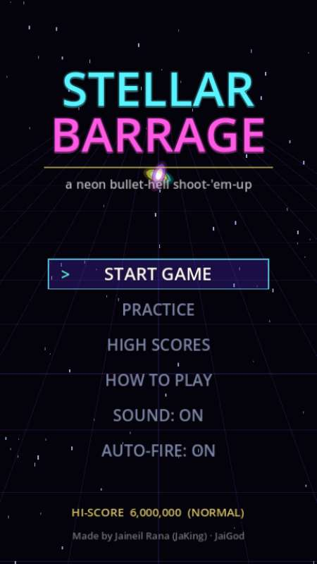
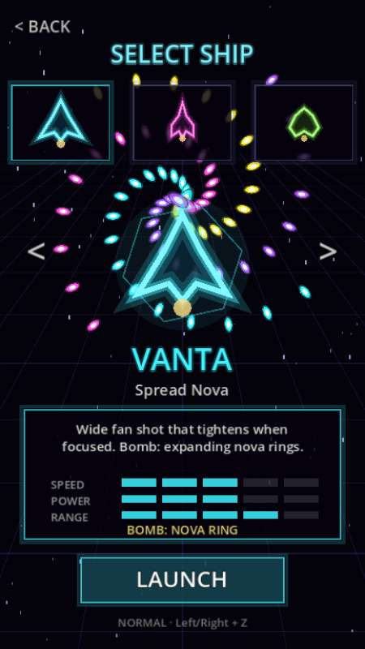
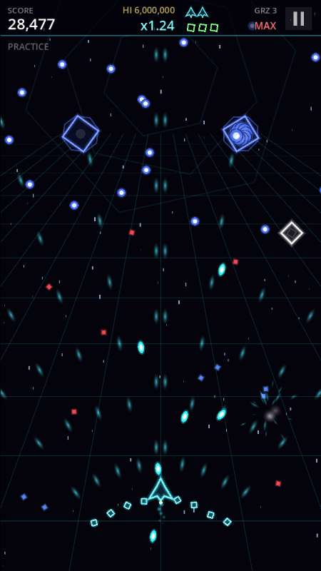
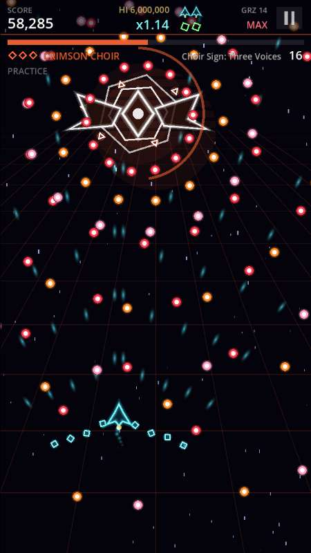
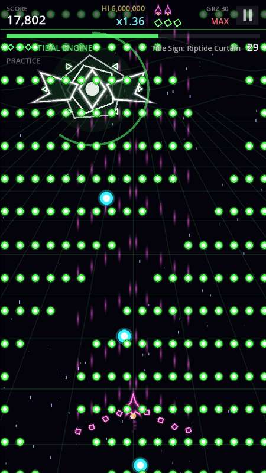
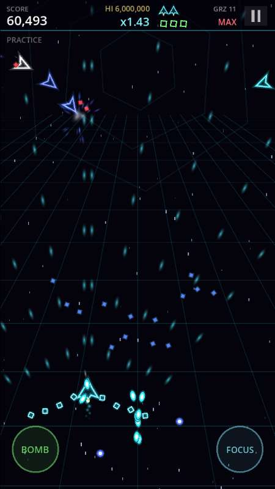

<div align="center">

# ✦ STELLAR BARRAGE ✦

**Thread the curtain. Graze the light. Break the star-gods.**

An original neon vertical **bullet-hell shoot-'em-up** made in **Godot 4**. Every ship, bullet, boss and note of music is generated in code.

[](https://jaigod.github.io/stellar-barrage/play/)

[](https://jaigod.github.io/stellar-barrage/)
[](https://godotengine.org)
[](https://github.com/JaiGod/stellar-barrage/actions/workflows/pages.yml)
[](LICENSE)
[](https://github.com/JaiGod)

</div>

## 📸 Screenshots

| Title | Ship select | Stage 1 |
|:---:|:---:|:---:|
|  |  |  |
| **Crimson Choir boss** | **Tidal Engine boss** | **Phone (touch-drag)** |
|  |  |  |

## ✨ Features

- 🚀 **3 ships**: **VANTA** (spread nova), **LANCE** (needle shots, focus fires a continuous beam) and **SEEKER** (homing swarm). Each has its own speed, focus shot and bomb.
- 🌌 **5 stages**: Halo Outskirts, Prism Expanse, Tidal Nebula, Crimson Corona and Null Zenith. Each has scripted enemy waves, a **mid-boss** and a **multi-phase boss** with named spell phases (20 boss phases in total).
- ✴️ **Graze system**: brushing past bullets builds a multiplier up to **x8**. Break a phase without dying or bombing for a **PERFECT BREAK** bonus.
- 💥 **Bombs**: clear the screen and turn bullets into star points. Press bomb in the moment after you are hit for a **deathbomb**.
- 🔋 **Power-ups**: red power items raise your shot through 4 levels. Blue point items are worth more near the top of the screen. Bomb items and score extends are in there too.
- 🎚️ **4 difficulties**: EASY, NORMAL, HARD and OVERDRIVE scale bullet speed and density.
- 🏆 **High scores**: a top-10 table per difficulty with arcade 3-letter name entry, plus up to 3 continues.
- 🎯 **Practice mode**: play any stage at full power with infinite respawns and a saved best score.
- ⚡ **Pooled bullets**: up to 4,000 enemy bullets live in packed arrays and draw in one `MultiMeshInstance2D` batch, so dense patterns stay smooth on phones.
- 📱 **Touch-drag movement**: relative drag, so your finger never covers the ship. Auto-fire while touching, with on-screen BOMB and FOCUS buttons.
- 🎵 **Procedural audio**: sound effects and chiptune music are synthesized into `AudioStreamWAV` at startup.
- 🎨 **Polish**: screen shake, flashes, particle bursts, phase-timer rings, boss warnings, pause menu, sound toggle and a saved ship/difficulty choice.

## 🎮 Controls

| Input | Move | Shoot | Bomb | Focus (slow + hitbox) | Pause | Mute |
|---|---|---|---|---|---|---|
| Keyboard | Arrows / WASD | Z / J | X / K | Shift / L | Esc / P | M |
| Gamepad | Stick / D-pad | A / RT | B / Y | X / LB / RB | Start | – |
| Touch | Drag anywhere | auto | BOMB button | FOCUS button | ❚❚ top right | – |

Auto-fire is on by default and can be toggled on the title screen.

## 🛠️ Tech stack

- **Godot 4.3** with GDScript and the **Compatibility (GL) renderer**, so the web build runs everywhere
- Web export with **threads off**, so it runs on GitHub Pages without COOP/COEP headers
- **GitHub Actions** with `barichello/godot-ci:4.3`: a headless smoke test, then the Web export, deployed to **GitHub Pages**
- No image or audio files: everything is drawn with `CanvasItem` calls or generated textures and synthesized audio

## 📁 Project structure

| Path | What it does |
|---|---|
| [`scripts/main.gd`](scripts/main.gd) | Menus, input map, save data (scores, practice bests, settings), touch controls, HUD |
| [`scripts/game.gd`](scripts/game.gd) | Run state, player ships, shots, bombs, graze, items, boss phases, stage flow, rendering |
| [`scripts/stages.gd`](scripts/stages.gd) | Stage timelines, enemy waves, mid-boss and boss definitions, 25+ named bullet patterns |
| [`scripts/pool.gd`](scripts/pool.gd) | Struct-of-arrays bullet/shot/item/particle pools rendered with MultiMesh |
| [`scripts/sfx.gd`](scripts/sfx.gd) | Procedural sound effects and music synthesizer |
| [`scripts/layer.gd`](scripts/layer.gd) | Tiny draw-callback layer node |
| [`tests/`](tests) | Headless smoke test: a bot clears all 5 stages with every ship, then tests game over, continue, bombs and practice |
| [`web/index.html`](web/index.html) | Landing page served at `/` (the game is at `/play/`) |
| [`.github/workflows/pages.yml`](.github/workflows/pages.yml) | Test, export and deploy pipeline |
| [`docs/screenshots/`](docs/screenshots) | README and landing page images |

## 🧪 Run locally

```bash
git clone https://github.com/JaiGod/stellar-barrage.git
cd stellar-barrage
godot --path .                                     # play in the editor/runtime (Godot 4.3+)
godot --headless --path . res://tests/SmokeTest.tscn   # prints SMOKE OK
godot --headless --path . --export-release "Web" build/play/index.html
cp web/index.html build/ && cd build && python3 -m http.server 8000
```

On the web build you can jump straight to a fight for testing, for example `play/?stage=3&boss=1&ship=1&god=1` (also `mid=1`, `diff=0-3`).

## 📓 Development log

- **Design goal**: a readable bullet hell. The hitbox is tiny (2.6 px) and shown while focused. Enemy bullets use a bright core with a coloured rim, drawn above everything else, so you can always see what kills you.
- **Bullet pool**: bullets are never nodes. Spawning and freeing a node per bullet would stutter when bosses fire full rings, so every bullet is a slot in a struct-of-arrays pool (one `PackedFloat32Array` per field). Each frame writes a single MultiMesh buffer, so a dense boss phase costs one draw call.
- **Graze and scoring**: graze is checked in the same loop as collision (a 15 px ring around the 2.6 px hitbox), so it costs nothing extra. Each bullet can only be grazed once, which stops you from farming one bullet.
- **Boss phases**: each phase has HP and a timer. Timing out still advances the fight but gives no bonus. Clearing a phase cancels every bullet on screen into star items, which feels great and is fair to the player.
- **Touch controls**: an absolute "ship follows finger" scheme would put the thumb over the ship, so movement is a relative drag (x1.3). BOMB and FOCUS sit in the bottom corners, away from the main dodge area.
- **Web build**: Compatibility renderer and threads off, so GitHub Pages can host it with no special headers.
- **Testing**: a headless bot plays complete runs with all 3 ships (invulnerable, boosted damage). It checks that every stage, mid-boss and boss phase is reached, that the bullet pool stays under its cap, and that high-score entry, game over, continues and practice all work. CI runs it before every deploy.
- **Beta tested on the live site ✅ (2026-11-05)**: _pending_

## 🔗 More from JaiGod

[Circuit Siege](https://github.com/JaiGod/circuit-siege) · [Voltline](https://github.com/JaiGod/voltline) · [The Hollow Between](https://github.com/JaiGod/the-hollow-between) · [Moonfarm](https://github.com/JaiGod/moonfarm) · [all JaiGod projects](https://github.com/JaiGod)

---

<div align="center">

Made by Jaineil Rana (JaKing) · part of [JaiGod](https://github.com/JaiGod) · [MIT License](LICENSE)

</div>
